# Lieutenant Fizz for DOS

<p align="center">
  
</p>

<p align="center">
  
  
  
  <a href="https://scottmorris.github.io/lieutenant-fizz-dos/"></a>
</p>

*Lieutenant Fizz — Episode 1: The Cocoa Caper* for MS-DOS. The game's own Rust simulation, from [`liminal-hq/lieutenant-fizz`](https://github.com/liminal-hq/lieutenant-fizz), runs as a 32-bit DOS program in VGA mode 13h (320 × 200, 256 colours) with AdLib music and effects, or PC-speaker effects. It fits a 1.44 MB floppy, runs in DOSBox, and runs in a browser through js-dos.

> **Status:** Episode 1 plays from the title through the overworld and every level, with boss dialogue, saves and options. The simulation matches the web build's exactly (800 checked state hashes). The opening titles, the opening, the ending and the credits are in. Nothing has run on real hardware yet. [`docs/STATUS.md`](docs/STATUS.md) has the full list, the measured speed and what has not been verified.

## Play it

**In a browser:** [scottmorris.github.io/lieutenant-fizz-dos](https://scottmorris.github.io/lieutenant-fizz-dos/). Click Play (browsers need a click before they will make sound) and use the keyboard. The page uses js-dos's `fast` OPL (AdLib) emulator; `?opl=default` or `?opl=compat` in the address loads the game with another, to compare the sound (`compat` plays the music wrongly). To check the sound itself, choose Quit from the title and type `TONETEST` at the DOS prompt: it plays an A (440 Hz) on the AdLib and then on the PC speaker (Restart starts the game again). Restart also starts without your saves, so **Download saves** under the emulator takes the game's saves (`AUTO.SAV`, `QUICK.SAV`, `SLOT1.SAV` to `SLOT4.SAV`) as a zip, and **Upload saves** puts them back: a zip from Download saves, or loose `.SAV` files.

**From a release:** [the releases page](https://github.com/ScottMorris/lieutenant-fizz-dos/releases) has a 1.44 MB floppy image (`-floppy.img`, volume label `FIZZ EP1`), the same files as a zip for copying to a real disk or folder (`-disk.zip`), the DOSBox demo (`-dosbox.zip`), the browser bundle (`-browser.jsdos`, for any js-dos 8 player), a debug zip (`-debug.zip`, the same game with its symbols, for reading a crash's traceback) and `SHA256SUMS`. The game in a release is stripped of its symbols and debugging sections, a quarter smaller. `CHANGELOG.md` lists what changed. `tools/make-release.sh <version>` builds them.

**In DOSBox:** unpack `dist/fizz-dos-demo.zip` (or build it, below) and run `dosbox --conf DOSBOX.CONF` in the folder. `FIZZ.EXE` starts at a system check in the manner of Keen's — the video, input, sound and machine hardware it found and a speed test of the real renderer — and Enter continues to the opening titles (any key skips them) and then the title. The game needs a VGA, an x87 and 10 MB of free memory; without one of them the check says what is missing and only Esc leaves. The sound is set on the Options screen.

| Key | Action |
|---|---|
| Arrows or WASD | Move (Up and Down also climb and look) |
| Ctrl or Z | Jump |
| Alt or X | Pogo stick |
| Space or C | Fire |
| Enter | Confirm: enter a level marker, dismiss a card |
| Esc | Pause menu, and back in a menu |
| F5 / F9 | Quick-save and quick-load, in `QUICK.SAV`, a slot of its own |
| Backspace | Back to the overworld map |
| PgUp / PgDn | Previous or next level |
| R, N, M, E | Restart the level; night mode; music on or off; effects on or off |

The Options screen has music, effects, which chip plays the effects, **frame rate** (auto, 60 Hz or 30 Hz), **detail** (auto, high or low, which drops the backdrop layers on slow machines) and night. Options are kept in `FIZZ.CFG` and game saves in `AUTO.SAV`, `QUICK.SAV` and `SLOT1.SAV` to `SLOT4.SAV`, all beside the game. `FIZZ.EXE [level|map]` starts in a level or on the map; `nopreview` skips the system check.

## Build it

You need `bash`, `python3`, `zip`, `curl`, `git`, `gcc` with 32-bit libraries, `rustup` and [Bun](https://bun.sh). `tools/setup.sh` checks for them (it does not install system packages), installs the Rust pieces that `rust-toolchain.toml` lists, downloads DJGPP, DOSBox Staging and CWSDPMI into `vendor/` with checksums, and clones the main game next to this repository if it is not there (the exporters and the determinism check read it; the committed assets build the game without it).

```bash
tools/setup.sh                 # prepare a fresh clone
m2/build.sh                    # build the simulation for DOS and compare it with the web build: PASS: 800 checkpoints
m4/build.sh --no-run           # build the playable m4/c/fizz.exe
tools/make-dist.sh             # pack dist/fizz-dos-demo.zip
tools/check.sh                 # everything the CI runs
tools/clean.sh                 # remove build outputs when disk space is short (--all also removes vendor/)
```

`m2/build.sh` is the check that matters most: it runs 16 levels for 3000 ticks and compares 800 state hashes with the web build's wasm. `m5/bench` counts instructions per frame natively and checks a frame checksum for five scenes, so speed work can show the picture did not change.

## How it works

The simulation never learns it is on DOS. A patched `no_std` copy of it (`m2/sim`, `m2/game`) is linked into a Rust runtime (`m2/dos-rt`) that draws, runs the menus and keeps the saves; a small C layer built with DJGPP (`m4/c`) sets the video mode, hooks the keyboard and timer interrupts and drives the sound chips. The x87's precision control is set to 53 bits so its results equal the web build's `f64`. Lighting is done with the palette: 16 colours at 14 brightness levels, chosen per 8 × 8 cell. [`docs/ARCHITECTURE.md`](docs/ARCHITECTURE.md) has the layers, the build pipeline and the rules that keep the simulation identical.

| Folder | What it holds |
|---|---|
| `m0` | Native determinism harness: hashes the simulation's state, to compare with the web build |
| `m2` | The simulation for DOS (`sim` and `game`: the main game's crates plus `patches/`), the DOS runtime (`dos-rt`) and the custom i486 target |
| `m3` | Sprite export, the sprite census and the screenshot converter |
| `m4` | The playable build: the C layer, the exporters and the sound converters |
| `m5` | `bench`, the instruction counter and frame checksums |
| `tools` | Setup, check, clean, fetch, run, pack and convert scripts, the DOSBox configuration |
| `dist`, `site` | The demo folder, and the GitHub Pages page |
| `docs` | Status, architecture and the milestone notes |
| `attic` | Superseded code from the first milestones, not built or tested |

## Licence

Apache-2.0 OR MIT, as the main game is (`LICENSE-APACHE`, `LICENSE-MIT`). CWSDPMI, the DOS extender that ships beside the game, and js-dos, which runs it in the browser, keep their own licences; see `NOTICE`.
